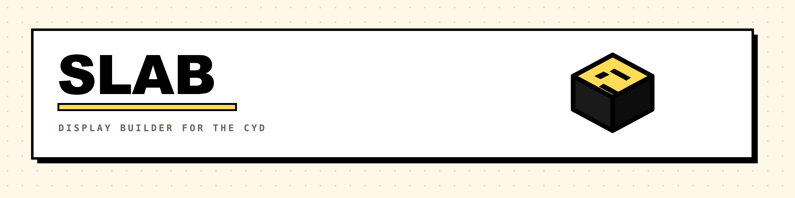

<div align="center">

<picture>
  <source media="(prefers-color-scheme: dark)" srcset=".github/banner-dark.png">
  
</picture>

### A display builder for the CYD. Drag, don't compile.

Assemble the dashboard for your "Cheap Yellow Display" in the browser —
29 field types, real data sources, custom fonts — then push it over USB.
**Without touching a line of C++.**

`ESP32-2432S028R` · `WebSerial` · `Next.js 16` · `TFT_eSPI`

</div>

---

## The idea

The CYD is a 2.8" ESP32 touch display for under $15. Showing something on it
normally means: open the Arduino IDE, hardcode the layout in C++, compile,
flash, find the typo, start over.

SLAB inverts that. The device runs **one** firmware — an interpreter. It reads
layout JSON and draws whatever is in it. You build that layout in the browser
with a mouse. One click on *Publish* pushes it over serial in under a second.

Want to move a field? Drag, publish, done. No compiler.

## What's in it

**29 field types** — text, value, bar, status dot, box, line, button, ring,
gauge, lamp, frame, page dots, trend, battery, signal, ticker, sparkline,
histogram, stat, clock, toggle, slider, stepper, choice, weather, icon, image,
QR code, repeater.

| | |
|---|---|
| **Dockable panels** | Move, tear off into their own window, collapse — the browser remembers your layout |
| **Data binding** | Any JSON API as a source. Pick the path from the actual response, with per-field transforms and threshold colours |
| **Auth** | Bearer, basic, custom header, query parameter — routed through the local proxy so credentials stay on the server |
| **Custom fonts** | Upload TTF/OTF or pull straight from Google Fonts. On publish the `.vlw` is generated at exactly the size the layout needs |
| **Images & QR** | Converted to RGB565 raw bitmaps and sent in blocks — the display can't decode PNGs |
| **Weather icons** | Meteocons, as a sequence of frames. They animate on the device |
| **Repeater** | Bind fields to a list: one template, any number of records |
| **Touch actions** | Page change or HTTP call. `{value}` in the URL is replaced with the new value |
| **Layout check** | Finds fields off-screen, dead bindings, invisible colours, oversized pushes — before the device does |
| **Firmware flashing** | Straight from the browser over WebSerial, falling back to slower baud rates |

## Why the device doesn't flicker

A dashboard rebuilt from scratch on every poll visibly flickers. So the firmware
keeps a signature per field, derived from its value and visibility. If nothing
changed, nothing is drawn.

When something does change, it doesn't clear the field's box from the layout —
it clears the area the field **actually painted** last time. A 48-point number
in a 20-pixel-tall field reaches far below it. Then everything touching that
area is redrawn, in layout order, so the stacking stays correct.

## Getting started

```bash
pnpm install
pnpm dev
```

Editor at `http://localhost:3000`. Chrome or Edge — WebSerial exists nowhere
else.

Then: **Connect** → **Flash firmware** (once) → **Set up Wi-Fi** → build a
layout → **Publish**.

The firmware ships as source under `firmware/` and is built with PlatformIO.
More on that and on the internals: **[DEVELOPMENT.md](DEVELOPMENT.md)**

## Hardware

Built for the **ESP32-2432S028R** (2.8" ILI9341, 320×240, XPT2046 touch). Other
sizes can be set in the editor — 3.5", portrait, Round 1.28" and T-Display S3
ship as presets. The firmware pin mapping in `firmware/platformio.ini` is for
the CYD and needs adjusting for other boards.

> **Note on language:** the editor UI and the source comments are in German.
> The docs are English.

## License

MIT. Weather icons from [Meteocons](https://github.com/basmilius/weather-icons)
(basmilius, MIT).
